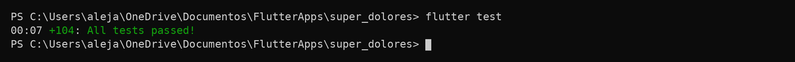

# 🌮 Super Dolores · Evidencia de pruebas (TDD)

Capturas de la terminal que documentan el ciclo **ROJO → VERDE** del proyecto `super_dolores` (Flutter), una SuperApp didáctica con mensajería, pagos, comercio y transporte.

- ❌ **ROJO**: la prueba falla porque el código todavía no existe.
- ✅ **VERDE**: con el código mínimo, la prueba pasa.

> Simulación didáctica: no mueve dinero real ni transporta personas.

> ⚠️ **Nota:** las capturas **08** (`vms_test`) y **09** (suite completa) reproducen una corrida real de `flutter test` (22 y 104 pruebas). Las demás (01–07) son **simuladas** con el mismo formato; sus conteos salen del manual y los ROJOS ilustran el fallo esperado.

## Resumen

| # | Archivo de pruebas | Resultado |
|---|--------------------|-----------|
| 1 | `dominio_test.dart` | ROJO ❌ |
| 2 | `dominio_test.dart` | VERDE ✅ (30 pruebas) |
| 3 | `servicios_test.dart` | ROJO ❌ |
| 4 | `servicios_test.dart` | VERDE ✅ (21 pruebas) |
| 5 | `retencion_test.dart` | ROJO ❌ |
| 6 | `retencion_test.dart` | VERDE ✅ (31 pruebas) |
| 7 | `vms_test.dart` | ROJO ❌ |
| 8 | `vms_test.dart` | VERDE ✅ (22 pruebas) |
| 9 | Suite completa | VERDE ✅ (104 pruebas) |

---

Cada captura va en orden: archivo de pruebas, resultado (ROJO = falla, VERDE = pasa) y la imagen.

## 1. Archivo `dominio_test.dart` (Rondas 2–5 y 8: dinero, monedero, eventos, mensajería, permisos)
**Resultado: ROJO ❌** — Falla: todavía no existen los archivos de `lib/dominio/` (`dinero.dart`, `excepciones.dart`, `eventos.dart`, `monedero.dart`, `mensajeria.dart`, `plataforma.dart`, `transporte.dart`).

```bash
flutter test test/dominio_test.dart --reporter expanded
```


## 2. Archivo `dominio_test.dart` (Rondas 2–5 y 8: dinero, monedero, eventos, mensajería, permisos)
**Resultado: VERDE ✅** — Con el código del dominio creado, pasan las 30 pruebas del archivo.

```bash
flutter test test/dominio_test.dart --reporter expanded
```


## 3. Archivo `servicios_test.dart` (Rondas 6, 7 y 12: comercio, transporte e integración)
**Resultado: ROJO ❌** — Falla: todavía no existen las clases que importa la prueba.

```bash
flutter test test/servicios_test.dart --reporter expanded
```


## 4. Archivo `servicios_test.dart` (Rondas 6, 7 y 12: comercio, transporte e integración)
**Resultado: VERDE ✅** — Pasan las 21 pruebas de comercio con comisión, transporte e integración entre servicios.

```bash
flutter test test/servicios_test.dart --reporter expanded
```


## 5. Archivo `retencion_test.dart` (Rondas 9–11: lealtad, analítica, notificaciones y sugerencias)
**Resultado: ROJO ❌** — Falla: todavía no existen `lealtad.dart`, `analitica.dart`, `notificaciones.dart` ni `sugerencias.dart`.

```bash
flutter test test/retencion_test.dart --reporter expanded
```


## 6. Archivo `retencion_test.dart` (Rondas 9–11: lealtad, analítica, notificaciones y sugerencias)
**Resultado: VERDE ✅** — Pasan las 31 pruebas del motor de lealtad, la analítica de retención y las notificaciones éticas.

```bash
flutter test test/retencion_test.dart --reporter expanded
```


## 7. Archivo `vms_test.dart` (Ronda 12: ViewModels)
**Resultado: ROJO ❌** — Falla: todavía no existen los ViewModels de `lib/presentacion/vm/`.

```bash
flutter test test/vms_test.dart --reporter expanded
```


## 8. Archivo `vms_test.dart` (Ronda 12: ViewModels)
**Resultado: VERDE ✅** — Pasan las 22 pruebas de los ViewModels (inicio, monedero, chat, tienda, viajes y métricas).

```bash
flutter test test/vms_test.dart --reporter expanded
```


## 9. Suite completa (Ronda 13)
**Resultado: VERDE ✅** — `flutter test`: pasan las 104 pruebas de los cuatro archivos.

```bash
flutter test
```



